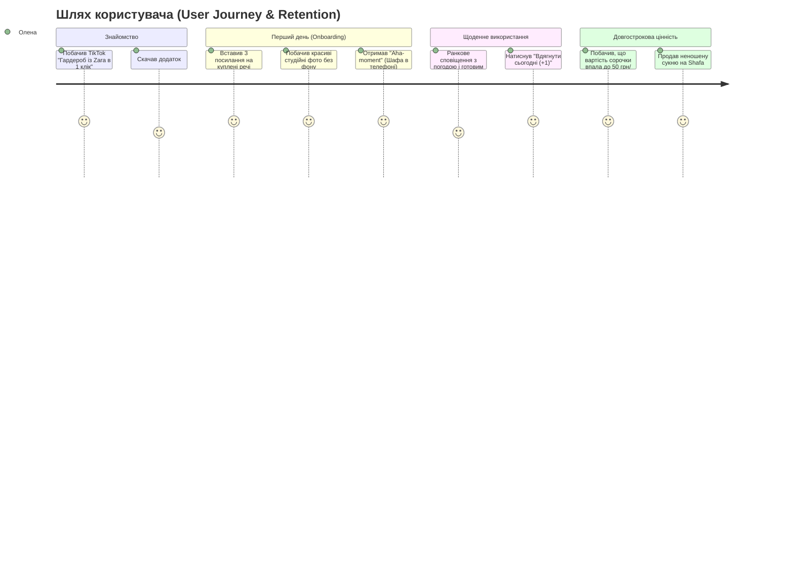

# Дослідження №2: Глибокий портрет ідеального клієнта (ICP Deep Dive)

## 1. Психологічний аналіз споживача (The Psychology of the Wardrobe)

Чому люди, які мають повні шафи одягу, щоранку щиро стверджують: *"Мені зовсім нічого вдягти!"*?

### 1.1. Парадокс вибору (The Paradox of Choice)
* Людський мозок у стані ранкового поспіху здатний утримувати у фокусі уваги не більше 4–5 варіантів комбінацій.
* Коли у фізичній шафі висить 150+ речей, виникає **когнітивне перевантаження (Analysis Paralysis)**. Людина стресує, здається і щодня обирає одні й ті самі перевірені джинси та худі, ігноруючи 80% гардероба.

### 1.2. Візуальна сліпота та приховані речі (Out of Sight, Out of Mind)
* Якщо річ лежить у другій лінії на полиці або в чохлі — для підсвідомості вона **перестає існувати**.
* Споживачі купують дублікати: кожна третя жінка випадково купує другу або третю практично ідентичну чорну водолазку чи білу футболку, бо забула про наявну.

### 1.3. Конфлікт "Фантазійного я" та "Реального життя" (Aspirational Wardrobe)
* До 30% покупок здійснюються для "ідеальної версії себе" (сукні для вечірок, високі підбори, екстравагантні костюми).
* У реальному житті (робота вдома, прогулянки, кав'ярні, офіс) цей одяг висить роками з бірками, викликаючи підсвідоме почуття провини за витрачені кошти.

---

## 2. Чотири ключові сегменти клієнтів (ICP Personas)

---

### Сегмент 1: "Втомлена онлайн-шопінгом" (Primary Core ICP — 55% ринку)
* **Профіль**: **Олена, 27 років**, Product Manager / Маркетолог у великому місті (Київ, Варшава, Берлін, Лондон, Нью-Йорк).
* **Дохід**: $1,500 – $4,000 / місяць.
* **Гардероб**: 150–250 одиниць одягу та взуття.
* **Звички шопінгу**: 
  - Купує онлайн 2–4 рази на місяць (Zara, Mango, ASOS, Kasta, Answear).
  - Шопінг є формою зняття стресу після робочого тижня.
* **Головні болі**:
  - Щоранку витрачає 20 хвилин на вибір одягу, в кімнаті утворюється безлад із переміряних речей.
  - Постійне відчуття: "Я витрачаю купу грошей на одяг, але виглядаю завжди однаково".
  - Ненавидить фотографувати речі на килимі чи простирадлі для додатків.
* **Jobs To Be Done (JTBD)**:
  > *"Коли я отримую посилку з одягом або відкриваю шафу вранці, я хочу в 1 клік бачити свій гардероб у телефоні, як у глянцевому журналі, щоб за 30 секунд зібрати стильний образ без стресу."*
* **Готовність платити**: 
  - $4.99/місяць або $39.99/рік за зручність імпорту та готові луки.
* **Канал залучення**: 
  - Вірусні TikTok / Instagram Reels відео ("Як я перенесла весь свій гардероб із Zara в додаток за 2 хвилини").

---

### Сегмент 2: "Капсульний раціоналіст" (The Conscious Minimalist — 25% ринку)
* **Профіль**: **Олександр або Марина, 34 роки**, IT-архітектор, фінансовий аналітик, власник бізнесу.
* **Дохід**: $3,000 – $8,000+ / місяць.
* **Гардероб**: 40–80 високоякісних речей (COS, Massimo Dutti, Arket, локальні дизайнери).
* **Звички шопінгу**: 
  - Усвідомлене споживання, покупка речей тільки з натуральних тканин (шерсть, кашемір, шовк, льон).
  - Рахує окупність кожної інвестиції.
* **Головні болі**:
  - Дратує неекологічність швидкої моди та захаращеність простору.
  - Хоче знати точний **Cost-Per-Wear (CPW)**: скільки коштував кожен вихід у костюмі за $600.
  - Бажає регулярно очищати шафу від того, що не носилося понад 6 місяців.
* **JTBD**:
  > *"Коли я планую гардероб на наступний сезон, я хочу бачити аналітику використання моїх речей, щоб точно знати, які 2 речі мені потрібно докупити, а що виставити на продаж."*
* **Готовність платити**: 
  - Висока ($50 – $90/рік за глибоку фінансову аналітику та списки ресейлу).
* **Канал залучення**: 
  - Тематичні блоги про мінімалізм, YouTube-огляди капсульного стилю, LinkedIn.

---

### Сегмент 3: "Діловий мандрівник" (The Busy Jetsetter — 15% ринку)
* **Профіль**: **Дмитро, 39 років**, топ-менеджер або консультант.
* **Дохід**: $5,000+ / місяць.
* **Гардероб**: 70–120 ділових та smart-casual речей.
* **Звички шопінгу**: 
  - Шопінг рідкісний, але дорогий (Hugo Boss, Suitsupply, Ralph Lauren).
  - 2–4 перельоти та відрядження на місяць.
* **Головні болі**:
  - **Пакування валізи**: завжди бере зайве або забуває базові елементи, що поєднуються.
  - Брак часу на роздуми про комбінації сорочок, піджаків та взуття.
* **JTBD**:
  > *"Коли я збираюся у відрядження на 3 дні у Варшаву, я хочу за 10 секунд отримати список з 7 речей під зустрічі та погоду, щоб усе помістилося в ручну поклажу."*
* **Готовність платити**: 
  - Максимальна ($9.99 – $14.99/місяць без вагань).
* **Канал залучення**: 
  - Партнерства з тревел-сервісами, рекомендації бізнес-спільнот.

---

### Сегмент 4: "Gen Z фешн-креатор" (The Aesthetic Stylist — 5% ринку)
* **Профіль**: **Софія, 20 років**, студентка, контент-креатор.
* **Гардероб**: Вінтаж, секонд-хенди, трендовий мас-маркет.
* **Потреба**: Створення красивих колажів у стилі Polyvore, естетичні мудборди для соцмереж.
* **Монетизація**: Низька пряма конверсія в підписку, але **максимальна віральність** (вони створюють безкоштовний UGC-контент у TikTok, який залучає Сегмент 1).

---

## 3. Матриця бар'єрів та тригерів активації

---

## 4. Стратегія утримання користувачів (Retention Strategy)
1. **Ранковий віджет та пуш-сповіщення**: 
   - *"Доброго ранку, Олено! Сьогодні в Києві +15°C, хмарно. Ваш рекомендований образ: Бежевий блейзер Massimo Dutti + біла сорочка Zara"*.
2. **Щотижневий звіт "Здоров'я гардероба"**:
   - *"Цього тижня ви вдягли 8 різних речей. Ваш найбільш вигідний айтем — кеди Reebok (45 грн/вихід)"*.
3. **Гейміфікація CPW**:
   - Візуальні бейджі: "Улюблена річ" (CPW < 50 грн), "Інвестиція окупилася", "Кандидат на ресейл".
