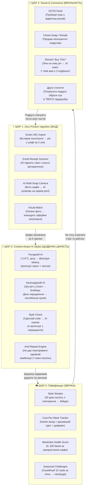

# Дослідження №4: Стратегія проривних інновацій та утримання користувачів
# (Innovation Moat & Retention Engine — Як перемогти конкурентів у всьому світі)

---

## Чесна відповідь на головне питання

> **"Чи ми будемо новаторами? Чи буде цей продукт мати великий успіх?"**

### Прямо: Сам по собі "цифровий гардероб" — це НЕ новинка. Але це НЕ проблема.

Instagram не був першою фото-соцмережею. Spotify не був першим музичним стрімінгом. Notion не був першим нотатником. Вони перемогли, тому що зробили **10x кращий досвід** на тому ж ринку.

Наша ситуація аналогічна:
- **Ринок існує** і швидко зростає (CAGR 20%+, $2.5B → $13B до 2032).
- **Існуючі рішення мають критичні слабкості**, які НІХТО з лідерів повноцінно не вирішив:
  1. **"Стіна налаштування"** (3–5 годин фотографування шафи) — 60–80% відтік у перший тиждень.
  2. **Щоденна корисність = 0** (немає причини відкривати додаток після першого введення).
  3. **Токсичні пейволи або застарілий UX** (Acloset блокує шафу; Stylebook виглядає як 2013 рік).

### Ми виграємо НЕ "новою ідеєю", а НОВИМ РІВНЕМ ВИКОНАННЯ:
**Zero-Friction Ingestion + AI Daily Value + Гейміфікація + Соціальний шар = продукт, який неможливо кинути.**

---

## Архітектура "Нездоланного рову" (Innovation Moat)

---

## Детальний опис кожного інноваційного шару

---

### ШАР 1: Zero-Friction Ingestion (Вхід без зусиль)

Це наша **кілер-фіча №1**, яку жоден конкурент не реалізував повноцінно. Мета: користувач заповнює гардероб за **5 хвилин замість 5 годин**.

| Функція | Як це працює | Чому це нове |
| :--- | :--- | :--- |
| **Smart URL Import** | Вставив лінк із Zara/ASOS/Kasta → AI витягує студійне фото, назву, бренд, категорію, ціну, колір, склад тканини за 2 секунди | Whering має базовий кліппер, але він працює лише для ~30% сайтів. Ми додаємо 3-рівневий парсер (Schema.org → Custom Adapters → AI Vision Fallback) |
| **Email Receipt Scanner** | Переслати лист-підтвердження замовлення → AI розбирає все → список речей із фото в 1 клік | **НІХТО з конкурентів цього не має**. Це абсолютна новинка для ринку |
| **AI Multi-Snap** | Фото відкритої шафи або рейлу → Vision AI сегментує кожну річ окремо, видаляє фон, створює картку | Конкуренти вимагають 1 фото = 1 річ. Ми дозволяємо оцифрувати 5–7 речей за 1 кадр |
| **Visual Match** | Погане фото речі → AI знаходить офіційне каталожне фото цієї моделі в HD через Visual Search | Indyx має щось подібне ("Enhance"), але обмежує безкоштовний доступ |

---

### ШАР 2: Context-Aware AI Stylist (Контекстний стиліст)

Саме цей шар перетворює додаток із "мертвого каталогу" у **щоденного помічника**, якого ХОЧЕТЬСЯ відкривати кожного ранку.

#### 2.1. Погодний AI-стиліст (Weather Intelligence)
- Інтеграція з OpenWeatherMap API (безкоштовний тариф: 1,000 запитів/день).
- Щоранку о 7:00 пуш-сповіщення: *"Київ, +14°C, дощ. Рекомендуємо: Тренч Massimo Dutti + Білі кеди Reebok (waterproof) + Шовкова сорочка Zara."*
- AI фільтрує **замшу при дощі**, **вовну при спеці**, **лляне при морозі**.

#### 2.2. Календарний AI (Calendar Context)
- Синхронізація з Google Calendar / Apple Calendar.
- Додаток "бачить" розклад дня:
  - 09:00 — Zoom-дзвінок з клієнтом → підбирає блейзер + сорочку.
  - 18:00 — Вечеря в ресторані → додає аксесуар (годинник, брошку).
  - Субота — Прогулянка → smart casual + зручне взуття.

#### 2.3. "Style Check" — AI-оцінка вашого образу
- **Абсолютно унікальна функція, якої немає ні в одного конкурента.**
- Користувач фоткає себе у дзеркалі → AI оцінює поєднання кольорів, пропорцій та фактур → видає бал (1–10) і конкретну пропозицію:
  - *"Образ 8/10. Замініть чорний ремінь на коричневий — і буде ідеально."*
- Використовує мультимодальну модель (Gemini Flash) для аналізу зображення.

#### 2.4. Anti-Repeat Engine (Антиповтор)
- Відстежує журнал носіння за останні 14 днів.
- Якщо ви вже 3 рази поспіль вдягали ті самі джинси + светр, AI пропонує: *"Спробуйте сьогодні ваші брюки COS — ви їх не вдягали 3 тижні."*
- Це змушує "перевідкривати" речі, які лежали в тіні.

---

### ШАР 3: Гейміфікація (Звичка як у Duolingo)

Чому Duolingo має 60M+ щоденних активних користувачів? Тому що **втрачати прогрес боляче**. Ми переносимо цю психологію на моду.

#### 3.1. Style Streaks (Стріки стилю)
- Кожен день, коли ви обираєте образ у додатку → стрік +1.
- 7 днів → бейдж "Тижневий стиліст" 🔥
- 30 днів → бейдж "Модний марафонець" + розблокування преміум-теми інтерфейсу.
- **Streak Freeze**: 1 "заморозка" на тиждень, щоб не втратити стрік через хворобу чи поїздку.

#### 3.2. Cost-Per-Wear Tracker (Дофаміновий трекер окупності)
- Щоразу, коли ви вдягаєте річ, її CPW (вартість одного носіння) ПАДАЄ.
- Анімований лічильник: *"Ваш блейзер Massimo Dutti: 4900 ₴ → 350 ₴/вихід → 245 ₴/вихід!"*
- Коли CPW падає нижче 100 ₴ → бейдж "Розумна інвестиція" 💎

#### 3.3. Wardrobe Health Score (Рахунок здоров'я шафи)
- Загальний бал від 0 до 100 на основі:
  - % речей, які ви вдягали за останні 90 днів.
  - Різноманітність комбінацій.
  - Баланс категорій (чи немає 40 футболок і 0 брюк).
- Щотижневий звіт: *"Здоров'я шафи: 72/100. Зовсім не торкали категорію 'Аксесуари' — додайте ваш шарф до завтрашнього образу!"*

#### 3.4. Seasonal Challenges (Сезонні виклики)
- *"Осінній виклик: створіть 15 різних образів із вашої шафи до 30 листопада → отримайте ексклюзивну тему 'Autumn Gold'."*
- Елемент змагання та обмеженого часу створює зацікавленість та FOMO (Fear of Missing Out).

---

### ШАР 4: Social & Commerce (Соціальний шар і комерція)

Цей шар перетворює кожного користувача на "агента залучення", який безкоштовно приводить нових юзерів.

#### 4.1. OOTD Feed (Стрічка образів)
- Користувач збирає аутфіт → натискає "Опублікувати" → образ потрапляє у соціальну стрічку.
- Кожен елемент образу є клікабельним: подруга бачить сукню → натискає → бачить бренд, ціну, і може додати подібну річ до СВОЄЇ шафи.

#### 4.2. "Should I Buy This?" — Антиімпульсивний радник
- **Геніальна фіча**: користувач знаходить нову річ в інтернет-магазині → ділиться лінком із додатком → AI перевіряє:
  - *"У вас уже є 3 бежеві топи. Цей четвертий створить лише 1 новий образ. Рекомендація: ПРОПУСТИТИ."*
  - АБО: *"Ця синя сорочка створить 7 нових образів із вашими існуючими брюками та взуттям! Рекомендація: КУПУВАТИ."*
- Це **позиціонує додаток як захисника гаманця**, а не як продавця.

#### 4.3. Closet Swap (Обмін та Ресейл)
- Неношені речі (CPW > 500 ₴ або 0 носінь за 180 днів) → AI генерує готовий опис і фото для продажу → 1 клік → публікація на Shafa/OLX/Vinted.
- Або "Swap з подругою": дві подруги бачать шафи одна одної та можуть запропонувати обмін.

#### 4.4. "Збери мені лук" (Crowd-Styling)
- Надіслати подрузі доступ до ВАШОЇ шафи → вона збирає аутфіт для вас → ви отримуєте готову рекомендацію.
- Соціальний engagement + емоційний зв'язок = додаток стає "спільним простором".

---

## Таблиця конкурентного "прориву" (Innovation Gap Analysis)

| Інноваційна функція | Whering | Acloset | Indyx | Stylebook | **МИ** |
| :--- | :--- | :--- | :--- | :--- | :--- |
| Smart URL Import (3-рівневий) | ⚠️ Частково | ❌ | ❌ | ❌ | ✅ **Повний** |
| Email Receipt Scanner | ❌ | ❌ | ❌ | ❌ | ✅ **Перші у світі** |
| AI Multi-Snap Camera | ❌ | ❌ | ❌ | ❌ | ✅ **Перші у світі** |
| Style Check (AI-оцінка образу у дзеркалі) | ❌ | ❌ | ❌ | ❌ | ✅ **Перші у світі** |
| Погодний AI + Календар | ❌ | ⚠️ Базовий | ❌ | ❌ | ✅ **Контекстний** |
| Anti-Repeat Engine | ❌ | ❌ | ❌ | ❌ | ✅ **Перші у світі** |
| Style Streaks (Гейміфікація Duolingo) | ❌ | ❌ | ❌ | ❌ | ✅ **Перші у світі** |
| Wardrobe Health Score (0–100) | ❌ | ❌ | ❌ | ❌ | ✅ **Перші у світі** |
| "Should I Buy This?" Антиімпульсник | ❌ | ❌ | ❌ | ❌ | ✅ **Перші у світі** |
| OOTD Social Feed | ⚠️ Базовий | ❌ | ❌ | ❌ | ✅ **Повний + клікабельний** |
| Crowd-Styling ("Збери мені лук") | ❌ | ❌ | ❌ | ❌ | ✅ **Перші у світі** |
| Virtual Try-On (AR Avatar) | ❌ | ❌ | ❌ | ❌ | 🔜 Phase 3 |

> **7 із 12 ключових функцій будуть ПЕРШИМИ У СВІТІ серед додатків цифрового гардероба.**

---

## Висновок: Чому ми виграємо

1. **Ми не конкуруємо "ще одним гардеробом"** — ми створюємо **перший AI Fashion OS**: операційну систему стилю, яка щоранку працює на вас.
2. **Кожен шар генерує наступний**: Легкий вхід → Щоденна звичка → Гейміфікований прогрес → Соціальне поширення → Нові користувачі.
3. **Захист від копіювання**: Навіть якщо конкуренти повторять окремі фічі, їм знадобиться 12–18 місяців, щоб побудувати всю систему. За цей час ми вже матимемо мережевий ефект (Social Layer).
