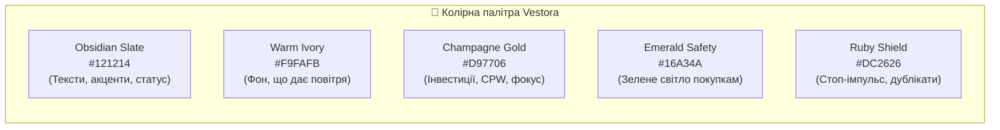
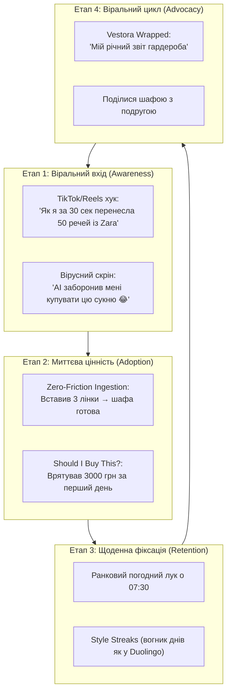

# Бренд-бук, Дизайн-система та Стратегія впровадження (Brand Book & Go-To-Market Strategy)

---

## ЧАСТИНА 1. ПЛАТФОРМА БРЕНДУ (Brand Identity)

### 1.1. Фінальна назва бренду: **VESTORA** (Весто́ра)
* **Походження**: Від латинського *Vestis* (одяг / вбрання) + *Aura* (відчуття стилю та внутрішньої впевненості) + *Store* (розумне володіння).
* **Чому ця назва переможе**:
  1. Звучить як преміальний європейський дім моди (на відміну від інфантильних назв конкурентів).
  2. Однаково природно та дорого вимовляється всіма мовами: в Україні, ЄС та США.
  3. Має чітку фонетику без подвійних трактувань: коротка, сильна, ритмічна.

### 1.2. Архетип бренду: **The Sage + The Creator** (Мудрець + Творець стилю)
* Vestora не повчає і не соромить за купу одягу. Вона — **спокійний, бездоганно одягнений персональний асистент**, який бачить усю вашу шафу, знає погоду, розуміє правила гармонії кольорів та оберігає ваш гаманець від дурних покупок.

### 1.3. Слогани та вербальні тригери:
* **Global (EN)**: *"Your Wardrobe, Elevated."* (Твій гардероб на новому рівні).
* **Supporting Tagline (EN)**: *"Wear what you own. Buy only what matters."*
* **UA Специфіка**: *"Твій гардероб. Твій стиль. Твій спокій."*
* **Продуктовий хук**: *"Додаток, який знає твою шафу краще, ніж ти сам."*

### 1.4. Концепція іконки додатку (App Icon):
* **Фон**: Глибокий оксамитовий графіт (*Obsidian Black* `#121214`).
* **Знак**: Елегантна золота монограма літери **"V"**, лінії якої плавно переходять у мінімалістичний силует вішалки для одягу (Champagne Gold `#EAB308` $\rightarrow$ Amber `#D97706`).
* **Ефект на екрані телефону**: Виглядає як іконка преміального консьєрж-сервісу поряд із додатками Vogue, Farfetch або Apple Wallet.

---

## ЧАСТИНА 2. ДИЗАЙН-СИСТЕМА ТА СТИЛІ (UI/UX Design Tokens)

Стиль додатку базується на концепції **"Quiet Luxury & Digital Clarity"** (Стриманий люкс та абсолютна візуальна ясність). Ніяких неонових кислотних рамок, ніякого візуального шуму — головний герой інтерфейсу це **одяг користувача**.

### 2.1. Палітра кольорів (Design Tokens):
| Токен | Hex | Використання | Емоція |
| :--- | :--- | :--- | :--- |
| `primary` | `#121214` | Основний текст, головні кнопки, темні статус-картки | Впевненість, дорожнеча, мінімалізм |
| `background` | `#F8F9FA` | Загальний фон екранів | Чистота студії, візуальний простір |
| `surface` | `#FFFFFF` | Картки одягу, модальні вікна | Свіжість, легкість |
| `accent` | `#D97706` | Бейджі Cost-Per-Wear, підсвічування обраного, іконки зірок | Преміальність, тепло, золото |
| `success` | `#16A34A` | Вердикт "Варто купити", окуповані речі | Безпека, розумний вибір |
| `danger` | `#DC2626` | Сигнал дубліката, попередження імпульсної покупки | Зупинка, увага |
| `border` | `#E4E4E7` | Тонкі елегантні лінії розділювачів (1px) | Акуратність, геометрія |

### 2.2. Типографіка:
* **Основний шрифт інтерфейсу**: `Plus Jakarta Sans` (Google Fonts). Сучасний європейський неогротеск, адаптований під ідеальне зчитування на дисплеях iPhone Retina та сучасних Android AMOLED.
* **Заголовки (`Display / H1`)**: `700 Bold`, letter-spacing `-0.5px`.
* **Фінансові цифри (CPW / Вартість)**: `800 ExtraBold`, моноширинні табличні цифри.

### 2.3. Правила оформлення інтерфейсу (Styling Principles):
1. **Студійна подача фото**: Одяг завжди має однаковий масштаб та пропорцію (4:5 для каталогу). Будь-яке завантажене фото автоматично вирівнюється по центру.
2. **М'які скруглення (Border Radius)**:
   - Картки товарів: `16px`.
   - Кнопки дій: `12px`.
   - Бейджі та чіпси: `20px` (Pill shape).
3. **Мікроанімації**:
   - При кліку "Вдягнути (+1)" — плавний сплеск частинок конфеті навколо лічильника CPW.
   - При аналізі "Should I Buy This?" — сканер-промінь проходить по картці за 1 секунду перед появою вердикту.

---

## ЧАСТИНА 3. СТРАТЕГІЯ ВПРОВАДЖЕННЯ: ЯК ЗРОБИТИ БРЕНД ВПІЗНАВАНИМ І ПОТРІБНИМ

Щоб продукт не просто завантажили, а **регулярно використовували та рекомендували друзям**, потрібна стратегія, побудована на глибоких людських болях та віральних механіках.

---

### 3.1. Чому бренд буде ПОТРІБНИМ (Pain-Killer, а не Vitamin):

| Біль людини | Як Vestora вирішує це в житті |
| :--- | :--- |
| **"Шафа ломиться, а вранці паніка і нема що вдягти"** | О 07:30 приходить одне готове рішення під погоду (+14°C, дощ) та розклад дня. Жодного стресу перед дзеркалом. |
| **"Купила чергову бежеву кофту і вдома зрозуміла, що в мене вже є дві такі"** | Кнопка *"Should I Buy This?"* у браузері або додатку блокує дублікати до того, як з карти списалися гроші. |
| **"Почуття провини за витрачені гроші на одяг, що висить із бірками"** | Додаток гейміфікує окупність: щоразу, як ви вдягли річ, вартість одного виходу падає (з 2000 ₴ до 60 ₴). А те, що не носиться 180 днів, в 1 клік готується на продаж. |

---

### 3.2. Стратегія Впізнаваності: 4 Віральні механізми (Growth Loops)

#### 1. Механіка "AI заборонив мені купувати" (Instagram Stories & TikTok)
* Користувач перевіряє сукню через *"Should I Buy This?"*.
* Додаток видає вердикт: **"НЕ КУПУЙТЕ 🚫. У вас уже є 3 подібні сукні (Mango, Zara), а вартість цієї — 4500 ₴"**.
* На екрані з'являється красива естетична картка для Instagram Stories: *"Vestora врятувала мій бюджет від чергової імпульсивної покупки"*. 
* Люди обожнюють ділитися самоіронією про свій шопоголізм — це дає **безкоштовний вірусний трафік подруг**.

#### 2. "Vestora Wrapped" (Аналог Spotify Wrapped для стилю)
* Кожні 3 місяці або в кінці року додаток генерує персональний глянець-звіт:
  - *"Ваш топ-1 айтем року — білі кеди (вдягнено 74 рази, всього 32 ₴ за вихід)"*.
  - *"Найдорожча помилка: сукня з шовку (вдягнено 1 раз = 3500 ₴ за вихід)"*.
  - *"Загальна вартість вашої шафи: 84 200 ₴"*.
* Це контент, який 80%+ активних жінок публікують у своїх соцмережах.

#### 3. UGC-кампанія у TikTok: "Zara Order to Digital Closet in 10 Seconds"
* Формат відео без замовних акторів: демонстрація екрана телефону.
* Сценарій: відкривається кошик Zara/Kasta $\rightarrow$ копіюється посилання $\rightarrow$ вставляється у Vestora $\rightarrow$ за 2 секунди з'являється ідеальне студійне фото, категорія і варіанти образів із домашнім одягом.
* Заклик: *"Перевір свій гардероб безкоштовно"*.

#### 4. Колаборації з локальними персональними стилістами
* Стилісти в Instagram/TikTok постійно проводять "розбори гардеробів" (це їхня основна платна послуга).
* Ми даємо стилістам інструмент: *"Проводьте розбір гардероба клієнта у Vestora за посиланням"*. Стиліст отримує зручний софт, а ми — десятки лояльних клієнтів від кожного стиліста.

---

### 3.3. План запуску бренду (Rollout Roadmap):

1. **Фаза 1: "Quiet Beta" (Тихий запуск для перших 500 модниць)**:
   - Закрите тестування серед ком'юніті капсульного стилю та фешн-блогерів України та Європи.
   - Фокус: доведення Smart URL імпорту до 99% надійності та збір захоплених відгуків.
2. **Фаза 2: Віральний запуск фічі "Should I Buy This?" (TikTok & Reels Blitz)**:
   - Запуск коротких динамічних відео про анти-імпульсивний шопінг.
   - Подача заявки на "App of the Day" в Apple App Store (дизайн у стилі Quiet Luxury має найвищі шанси на фічеринг редакцією Apple).
3. **Фаза 3: Впровадження Social Layer та Resale**:
   - Запуск OOTD-стрічки та обміну луками між подругами, партнерська інтеграція з ресейл-майданчиками.
