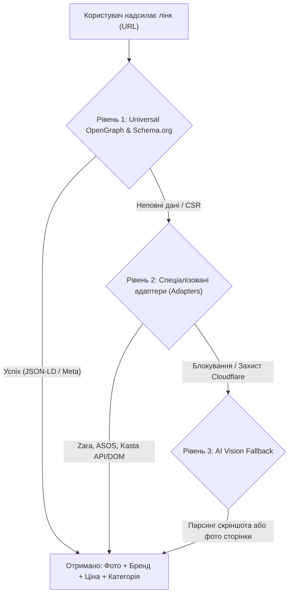

# Стратегія парсингу інтернет-магазинів (US, EU, Ukraine)

Цей документ визначає архітектуру модуля **"Smart URL Importer"**, який дозволяє користувачеві вставити посилання на куплену річ або натиснути кнопку *"Поділитися"* у мобільному браузері, після чого додаток за 2-3 секунди витягує студійне фото без зайвих деталей, назву, бренд, колір, склад та ціну.

---

## 1. Цільові ринки та пріоритетні магазини

### 1.1. Україна (Local Market UA)
1. **Kasta.ua** — лідер швидкого fashion-шопінгу в Україні.
2. **Intertop.ua** — найбільший агрегатор взуття та брендового одягу (Geox, Ecco, Tommy Hilfiger тощо).
3. **Answear.ua** — дуже популярний мультибрендовий магазин із європейськими складами.
4. **MD-Fashion.com.ua** — преміум та мідл-сегмент (Calvin Klein, Diesel, Tommy Hilfiger, Under Armour).
5. **Shafa.ua** — ресейл-майданчик (дозволяє імпортувати речі, куплені у селебріті або на вторинному ринку).
6. **Rozetka (Категорія "Одяг та взуття")** — великий маркетплейс із масовими покупками.
7. **Zara.com/ua / Mango.com/ua / H&M UA**.

### 1.2. Європа (EU Market)
1. **Zalando** (Німеччина, Польща, вся Європа) — найбільша платформа fashion-рітейлу в ЄС.
2. **ASOS** (EU версія) — культовий магазин серед молоді та студентів.
3. **Zara / Inditex Group** (Zara, Bershka, Stradivarius, Pull&Bear, Massimo Dutti, Oysho) — основа гардероба 70%+ європейців.
4. **H&M Group** (H&M, COS, & Other Stories, Arket).
5. **Mango** (Іспанія, міжнародна експансія).
6. **Farfetch / Mytheresa** — преміум та люкс сегмент.
7. **About You** — швидкий молодіжний рітейлер у Центральній та Східній Європі.

### 1.3. Сполучені Штати (US Market)
1. **Amazon Fashion** — лідер за обсягом замовлень повсякденного одягу.
2. **Nordstrom / Nordstrom Rack** — мідл та преміум одяг.
3. **Target (Fashion)** — доступний базовий одяг.
4. **Nike / Adidas / Lululemon** — спортивний та athleisure стиль.
5. **ASOS US / Zara US / Shein / Uniqlo US**.

---

## 2. Трирівнева архітектура парсингу (Parsing Engine)

Більшість сайтів намагаються блокувати спам-ботів (Cloudflare, Akamai), тому звичайний web scraping одного типу часто ламається. Ми застосовуємо 3-рівневий підхід:

### Рівень 1: Універсальний парсер метаданих (Universal Parser)
* 80% сучасних e-commerce сайтів підтримують семантичну розмітку:
  - `schema.org/Product` (JSON-LD або Microdata)
  - OpenGraph теги: `og:image`, `og:title`, `og:description`, `product:price:amount`, `product:price:currency`
* **Перевага**: Працює для тисяч магазинів по всьому світу без написання окремого коду для кожного сайту!

### Рівень 2: Спеціальні адаптери (Custom Adapters)
* Для топ-магазинів (Zara, Kasta, Intertop, ASOS, Zalando), де сторінки рендеряться через SPA (React/Vue/Angular):
  - Адаптер звертається до відкритих внутрішніх JSON API або використовує оптимізовані селектори.
  - Витягує якісні фотографії товару на білому фоні (Studio Photos) у високій роздільності.

### Рівень 3: AI Vision Fallback (Резервний інтелект)
* Якщо магазин повністю закритий захистом (наприклад, Farfetch або SSENSE з суворим Cloudflare Bot Management):
  - Користувач може поділитися скріншотом товару або фото сторінки через системне меню "Share".
  - Мультимодальна модель (Gemini 2.5 Flash) миттєво зчитує зі скріншота: фото речі, бренд, назву, категорію та ціну.
  - Жоден сайт у світі не зможе заблокувати цей метод!
