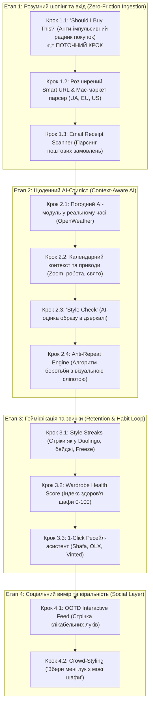

# Покроковий план реалізації продукту (Step-by-Step Implementation Roadmap)

Цей план розбиває створення найрозумнішого у світі цифрового гардероба на чіткі, послідовні кроки. Кожен крок фокусується на **одній завершеній функції**, проходить повне тестування та супроводжується звітом перед переходом до наступного.

---

## 🗺️ Загальна карта етапів

---

## Детальний розпис кожного кроку

### 🟢 Етап 1: Розумний шопінг та вхід
* **Крок 1.1 (Зараз в роботі)**: **"Should I Buy This?" (Чи варто купувати?)** — перевірка речі перед покупкою. AI оцінює, чи є дублікати в шафі, скільки нових образів річ створить та чи варто витрачати гроші.
* **Крок 1.2**: **Розширений Universal Parser** — оптимізована адаптація для Kasta, Intertop, Answear.ua, Zara, ASOS, Mango, Nike з підтримкою витягування складу тканини та оригінальних галерей фото.
* **Крок 1.3**: **Email Receipt Scanner** — симуляція та обробка чеків замовлень для імпорту всього кошика в 1 тап.

### 🟡 Етап 2: Контекстний AI-Стиліст
* **Крок 2.1**: **Real-Time Weather Context** — прив'язка до локальної температури, опадів та вітру; розумні фільтри тканин (блокування замші в дощ, рекомендація термошарів).
* **Крок 2.2**: **Календар подій** — розподіл луків за форматом: ділова зустріч, кежуал, вечірка, тренування.
* **Крок 2.3**: **Style Check** — фото в повний зріст $\rightarrow$ комп'ютерний зір видає оцінку балансу силуету (1-10) та 1 пораду для покращення.
* **Крок 2.4**: **Anti-Repeat Engine** — відстеження журналу виходів, підсвічування "забутих" речей.

### 🟣 Етап 3: Гейміфікація та звички
* **Крок 3.1**: **Style Streaks** — вогняний лічильник днів поспіль, календар стріків, захист від пропуску (Streak Freeze).
* **Крок 3.2**: **Wardrobe Health Score** — метрика ефективності шафи (0–100) з рекомендаціями збалансування.
* **Крок 3.3**: **Ресейл-генератор** — автоматичне формування картки товару для неношених речей (Shafa / OLX / Vinted).

### 🔵 Етап 4: Соціальний вимір
* **Крок 4.1**: **OOTD Feed** — інтерактивний лукбук дня, де кожен елемент образу клікабельний і показує бренд/ціну.
* **Крок 4.2**: **Crowd-Styling** — можливість поділитися приватним посиланням на шафу з подругою чи стилістом, щоб вони зібрали образ.
